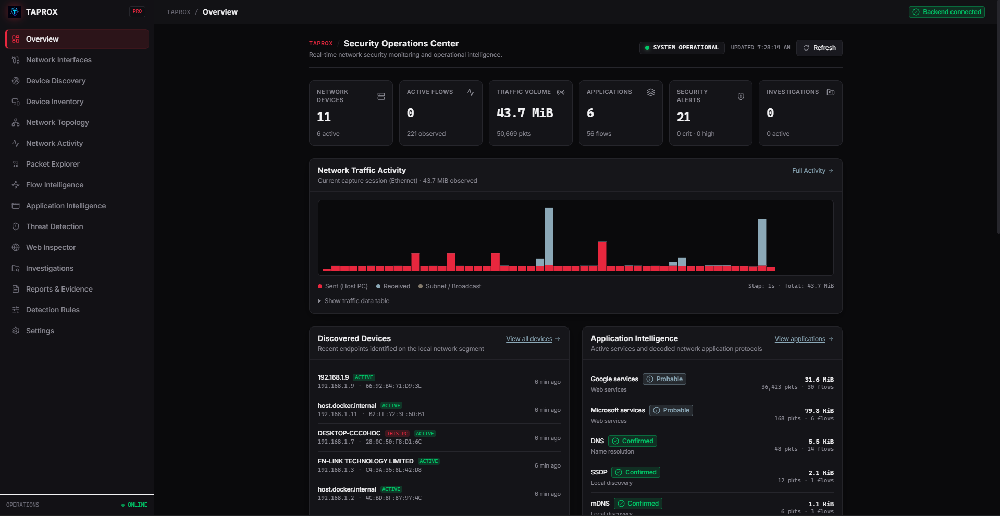
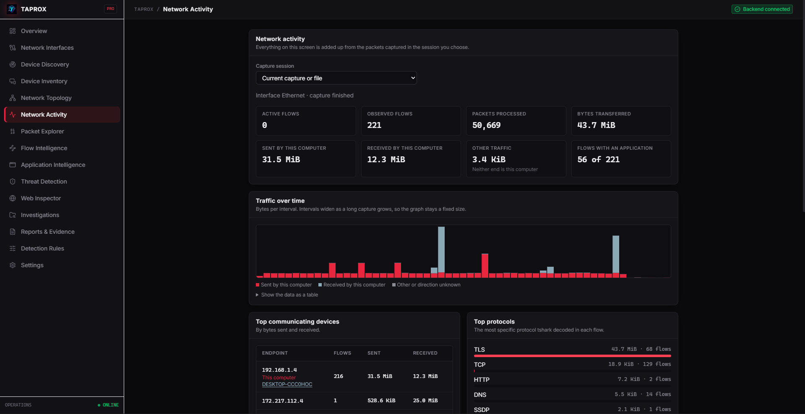
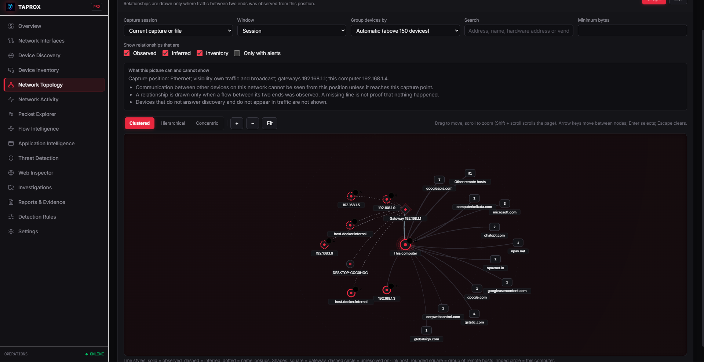
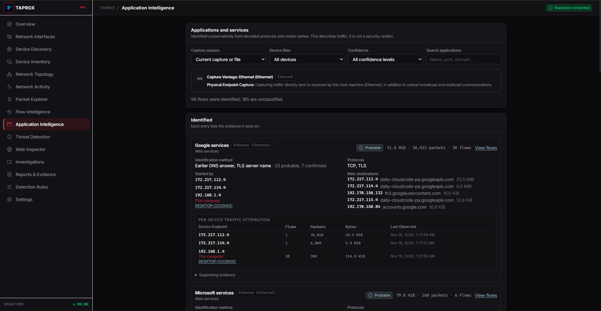
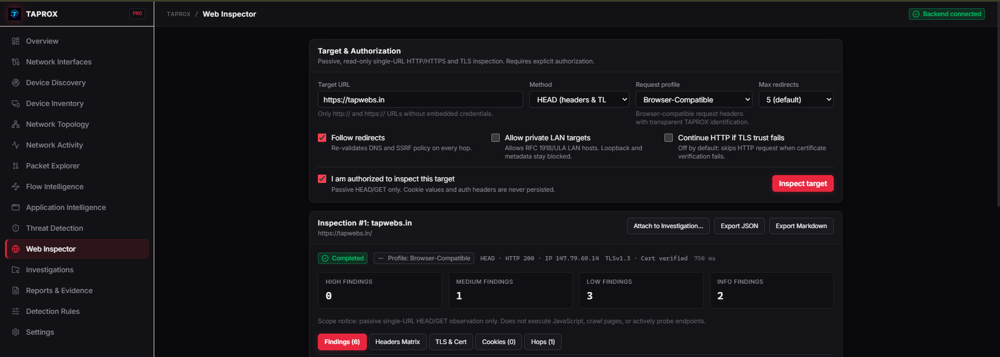
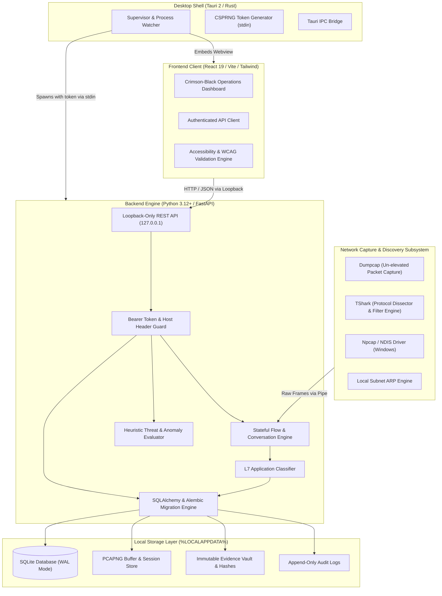

<p align="center">
  
</p>

<h1 align="center">
  
  TAPROX
</h1>

<p align="center">
  <strong>Network Visibility, Packet Intelligence & Web Security Testing Platform</strong><br />
  <em>Unified network visibility, packet intelligence, application identification, and cybersecurity investigation in one local-first desktop platform.</em>
</p>

<p align="center">
  
  
  
  
  
  
  
  
</p>

---

## Executive Overview

**TAPROX** is a local-first cybersecurity operations and network intelligence desktop application developed by **TAPWEBS**. Built for security operators, network engineers, incident responders, and researchers, TAPROX provides real-time traffic visibility, deep packet inspection, automated host discovery, layer-7 application classification, rule-driven threat detection, and forensic evidence management.

Unlike cloud-dependent telemetry services, TAPROX operates with strict privacy boundaries: **100% of network data, packet traces, forensic artifacts, and analysis databases remain strictly on your local device**.

<br />

<p align="center">
  
  <br />
  <em>Figure 1: TAPROX Unified Cybersecurity Operations Center dashboard displaying live telemetry, packet metrics, and active threats.</em>
</p>

---

## Core Capabilities

TAPROX organizes the complete defensive network lifecycle into 14 purpose-built, accessible modules:

| Module | Route | Operational Function |
|---|---|---|
| **Operations Center** | `#/overview` | Executive telemetry cockpit displaying interface activity, active flows, threat alerts, and system health. |
| **Network Interfaces** | `#/interfaces` | Hardware adapter audit showing MAC addresses, IP assignments, link speeds, MTU, and promiscuous capabilities. |
| **Device Discovery** | `#/discovery` | Subnet reconnaissance supporting passive ARP listening and consent-gated active host probing (`SendARP`). |
| **Device Inventory** | `#/devices` | Persistent asset registry tracking sighting timelines, reverse DNS hostnames, and MAC OUI manufacturer identification. |
| **Network Topology** | `#/topology` | Interactive node-link graph mapping gateway relationships, endpoints, communication clusters, and unobserved hosts. |
| **Network Activity** | `#/activity` | Bandwidth throughput and packet-rate timeline graphing with protocol distribution (TCP, UDP, ICMP, DNS, TLS). |
| **Packet Explorer** | `#/packets` | Deep packet capture (PCAPNG) inspection featuring native Wireshark display filter syntax and interactive hex dissection. |
| **Flow Intelligence** | `#/flows` | Bidirectional 5-tuple stateful conversation tracking aggregating packet volumes, bytes, TCP flags, and duration. |
| **Application Intelligence** | `#/applications` | Layer-7 application attribution combining TLS SNI, HTTP headers, and protocol signatures with per-device breakdowns. |
| **Threat Detection** | `#/threats` | Rule-based behavioral anomaly detection flagging DNS tunneling, NXDOMAIN bursts, port sweeps, and cleartext auth. |
| **Web Inspector** | `#/web-inspector` | Active security auditing of HTTP/TLS endpoints evaluating CSP/HSTS headers, cookie flags, and SSRF policies. |
| **Investigations** | `#/investigations` | Incident case management linking related alerts, flow records, and PCAP slices into evidence vaults. |
| **Reports & Evidence** | `#/reports` | Cryptographic evidence verification (`Verify All`) and tamper-evident ZIP export with SHA-256 manifests. |
| **Detection Rules** | `#/rules` | Configurable heuristic thresholds, sensitivity sliders, and per-device rule suppression controls. |

---

## Product Showcase

### 1. Network Activity & Throughput Telemetry
Real-time traffic graphing tracking sent, received, and broadcast volume across configurable sliding time windows.
<p align="center">
  
</p>

### 2. Interactive Network Topology
Spatial visualization linking gateways, active endpoints, and inventory devices with accessible keyboard navigation and adjacency matrices.
<p align="center">
  
</p>

### 3. Application Intelligence & Attribution
Identifies protocols, web services, and applications from visible packet signatures without relying on deceptive port numbers.
<p align="center">
  
</p>

### 4. Active Web Security Inspector
Validates transport layer security, cipher strength, cookie attributes (`HttpOnly`, `SameSite`, `Secure`), and security headers.
<p align="center">
  
</p>

---

## System Architecture

TAPROX combines a native Rust supervisor with an un-elevated Python backend and an accessible, modern React dashboard:



### Architectural Highlights
- **Tauri 2 Desktop Shell**: Lean, memory-safe Rust wrapper providing native operating system integration without Chromium bloat.
- **FastAPI Core**: High-throughput asynchronous backend service managing flow aggregation, packet streaming, and database migrations.
- **Strict Separation of Privilege**: Packet capture runs un-elevated; administrative privileges are never required or requested during normal operations.
- **Contract-Driven API**: Frontend and backend interact via fully typed, machine-validated OpenAPI contracts (`shared/api-contracts`).

---

## Security & Privacy Architecture

TAPROX is architected under the principle of **Defensive Computing and Absolute Data Locality**:

1. **Loopback Exclusive (`127.0.0.1`)**: The backend binds strictly to `127.0.0.1` using `SO_EXCLUSIVEADDRUSE` on an ephemeral port. Remote network binding is architecturally disabled.
2. **CSPRNG Stdin Token Authentication**: At launch, the Rust shell generates a 256-bit cryptographic token and writes it directly to the backend's standard input. Tokens never appear in command-line arguments, process inspection lists, or environment files.
3. **DNS Rebinding & Host Validation**: All incoming HTTP requests validate the `Host` header against verified loopback addresses; arbitrary domain headers receive immediate `403 Forbidden` responses.
4. **Credential & Secret Redaction**: Diagnostic logs automatically scrub bearer tokens, session cookies, authorization headers, and inspection secrets before writing to disk (`logs/backend.log`).
5. **Cryptographic Chain of Custody**: Evidence files recorded during incident response are tracked via SHA-256 digest chains in SQLite to ensure evidentiary integrity.
6. **Vantage Transparency**: TAPROX explicitly indicates capture vantage realities. Ordinary Wi-Fi station mode is clearly documented as unable to capture third-party wireless unicast traffic due to Access Point station isolation; enterprise SPAN or hardware TAP interfaces are accurately recommended for complete multi-host wireless inspection.

---

## Installation & Quick Start

### System Requirements

| Platform | Minimum Supported Version | Architecture |
|---|---|---|
| **Windows** | Windows 10 (22H2+) / Windows 11 | 64-bit (`x64`) |
| **Linux** | Ubuntu 24.04+ / Debian 12+ | 64-bit (`x86_64`) |

### Development Toolchain Prerequisites

| Component | Status | Required Version | Purpose |
|---|---|---|---|
| **Node.js** | **Required** | `22.12.0+` (LTS) | Dashboard compilation and frontend dev server |
| **Python** | **Required** | `3.12+` | Backend application engine and flow analytics |
| **Rust** | **Optional** | `1.85+` (MSVC) | Native Tauri desktop shell compilation |
| **Wireshark** | **Optional** | `4.2+` | Packet dissection engine (`dumpcap`, `tshark`) |
| **Npcap** | **Optional** | `1.70+` | Windows packet capture driver (un-elevated mode) |

> [!NOTE]
> **Wireshark and Npcap are strictly optional.** Device Discovery (ARP), Network Topology, Device Inventory, Web Inspector, and Evidence Vaulting operate fully without them. Only live packet capture in **Packet Explorer** requires Npcap/Wireshark.

---

### Windows Automated Quick Start

#### Step 1: Clone the Repository
```powershell
git clone https://github.com/tapwebs/TAPROX.git
cd TAPROX
```

#### Step 2: Diagnostic Check (Read-Only)
Verify your host toolchain against project requirements:
```powershell
powershell -NoProfile -ExecutionPolicy Bypass -File .\scripts\check-requirements.ps1
```

#### Step 3: Automated Environment Setup
Installs npm packages, configures Python virtual environment (`backend/.venv`), installs pinned dependencies, and runs database migrations:
```powershell
powershell -NoProfile -ExecutionPolicy Bypass -File .\scripts\setup-windows.ps1
```

#### Step 4: Launch Application
```powershell
# Option A: Browser Dashboard (Fastest, requires no Rust compiler)
powershell -NoProfile -ExecutionPolicy Bypass -File .\scripts\start-windows.ps1

# Option B: Native Desktop Window (Requires Rust toolchain)
powershell -NoProfile -ExecutionPolicy Bypass -File .\scripts\start-windows.ps1 -Desktop
```
Access the dashboard in your browser at **[http://127.0.0.1:5173](http://127.0.0.1:5173)**.

---

### Manual Cross-Platform CLI Workflow

```bash
# 1. Install root & workspace npm dependencies
npm install

# 2. Configure Python virtual environment and dependencies
python3 -m venv backend/.venv
source backend/.venv/bin/activate       # On Windows: .\backend\.venv\Scripts\Activate.ps1
pip install -r requirements.txt
pip install -r requirements-dev.txt

# 3. Start development stack
npm run dev             # Browser mode: http://127.0.0.1:5173
```

### Running Test & Verification Suites

```bash
# Backend unit, security, and flow tests (Pytest)
pytest backend/tests

# Frontend UI, accessibility (axe-core), and component tests (Vitest)
npm run test --workspace @tapnettrack/dashboard

# Typecheck full TypeScript codebase
npm run typecheck

# Full production dashboard build
npm run build
```

---

## Repository Structure

```text
TAPROX/
├── apps/
│   └── dashboard/              # React 19 frontend application
│       ├── src/                # Component architecture, features, and hooks
│       ├── public/             # Static brand assets and product screenshots
│       └── package.json        # Frontend workspace configuration
├── backend/                    # Python FastAPI application
│   ├── app/                    # API endpoints, models, flows, and threat rules
│   │   ├── api/v1/             # REST endpoints (interfaces, flows, alerts, etc.)
│   │   ├── database/           # SQLite engine and Alembic migration scripts
│   │   └── services/           # Capture, discovery, flow engine, and forensic vault
│   ├── packaging/              # PyInstaller spec files for frozen distribution
│   └── pyproject.toml          # Python package and dependency configuration
├── shared/
│   └── api-contracts/          # TypeScript contracts and exported OpenAPI schemas
├── data/                       # Local runtime data directory (git-ignored)
│   ├── tapnettrack.db          # Active SQLite operational database
│   ├── capture/                # Ephemeral PCAPNG capture slices
│   └── logs/                   # Diagnostic rotating application logs
├── scripts/                    # Platform setup, build, and release automation
├── docs/                       # Architecture, security reviews, and verification specs
└── README.md                   # Platform documentation
```

> [!NOTE]
> The native Tauri desktop wrapper (`apps/desktop/`) and internal testing suites are retained locally and in private packaging automation. The public repository provides the complete standalone web dashboard and FastAPI backend service.

---

## Development Status & Limitations

### Verified Capabilities
- [x] Un-elevated live packet capture via `dumpcap` process supervision.
- [x] Wireshark display filter compilation and frame dissection.
- [x] Subnet ARP discovery with explicit consent gating.
- [x] Topology mapping with accessibility support (WCAG compliant).
- [x] Stateful flow reconstruction and Layer-7 application fingerprinting.
- [x] Forensic evidence bundling with SHA-256 custody chains.
- [x] Web security evaluation (CSP, HSTS, Cookie security, TLS auditing).

### Known Operational Boundaries
- **Wi-Fi Monitor Mode**: In standard managed mode, wireless network adapters cannot inspect unicast traffic belonging to third-party devices due to 802.11 AP isolation. TAPROX reflects this honestly and recommends switch mirror/TAP configurations for total visibility.
- **Windows Architecture**: Native NSIS release targets 64-bit `x64` Windows. Windows on ARM64 operates via x64 compatibility emulation.
- **Administrative Rights**: Packet capture drivers (Npcap) must be installed with non-admin capture access permitted.

---

## Security Disclosure

If you discover a security vulnerability in TAPROX, please report it responsibly:
- **Preferred Method**: Submit a private advisory via [GitHub Private Vulnerability Reporting](https://github.com/tapwebs/tapnettrack/security/advisories/new) on the repository.
- **Alternative**: Open an issue flagged as security-sensitive with steps to reproduce.
- Please do not submit public issues containing undisclosed zero-day exploits or sensitive crash traces.

---

## Licensing & Distribution

**TAPROX** is developed by **TAPWEBS**.
- **Source Status**: Private source distribution (`"private": true` in `package.json`).
- **Copyright & Ownership**: All rights are reserved by the original authors. Public distribution, commercial bundling, or external publishing requires prior written authorization from TAPWEBS.
- **Third-Party Boundary Compliance**: TAPROX does not bundle proprietary packet drivers (such as Npcap) or GPL-licensed Wireshark binaries. All external tools are interfaced externally through standard operating system pipes in accordance with their respective distribution policies. See [docs/NOTICES.md](docs/NOTICES.md) for full details.

---

<p align="center">
  <strong>TAPROX</strong> — Engineering secure, local-first network visibility.
  <br />
  Developed by <strong>TAPWEBS</strong>.
</p>
