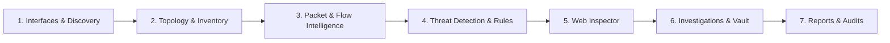
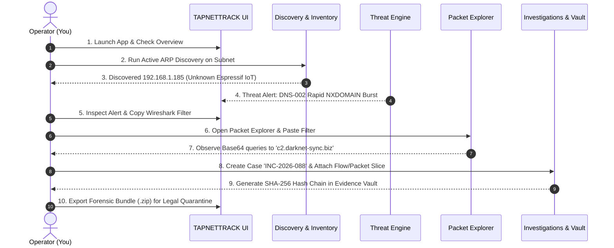

# TAPNETTRACK — Complete Functional Guide & Field Operator Handbook

**TAPNETTRACK** is a local-first, privacy-respecting network visibility, packet intelligence, and web security testing suite. It operates entirely on your machine without external cloud dependencies, telemetry, or remote command execution.

---

## Part 1: Comprehensive Section & Option Reference

The navigation sidebar organizes the entire network defense lifecycle into 15 integrated modules.

---

### 1. Overview (`#/overview`)
* **Purpose:** High-level operational executive dashboard showing real-time health, alert counts, and interface activity.
* **Key Components & Options:**
  - **Status Hero Card:** Shows backend connection state, current listening loopback port (`127.0.0.1:<port>`), and active database engine.
  - **Stat Metrics Grid:** Quick indicators for Discovered Devices, Active Flows, Unresolved Threat Alerts, and Open Investigations.
  - **Quick Action Launchers:** Shortcuts to initiate a network scan, start a live packet capture, or launch a Web Inspection.

---

### 2. Network Interfaces (`#/interfaces`)
* **Purpose:** Inspect physical and virtual network adapters present on the host operating system.
* **Key Components & Options:**
  - **Interface Selector:** List of network interface cards (NICs) such as Ethernet, Wi-Fi, and virtual adapters with MAC addresses, IPv4/IPv6 assignments, and link speeds.
  - **Operational State Badges:** Displays whether an interface is `Up`, `Down`, or `Loopback`.
  - **Interface Selection:** Selecting an interface designates it as the active target for subsequent ARP/ICMP discovery and live packet captures.

---

### 3. Device Discovery (`#/discovery`)
* **Purpose:** Safe, local-only reconnaissance of devices on your subnet.
* **Key Components & Options:**
  - **Interface & Subnet Selector:** Displays the target CIDR block (e.g., `192.168.1.0/24`). Limits maximum scope to `/22` (1024 addresses) to prevent accidental broad-network flood.
  - **Passive vs. Active Mode:**
    - *Passive Scan:* Listens to ARP and broadcast packets already on the wire without transmitting probes.
    - *Active Scan:* Emits localized `SendARP` requests across the CIDR range to detect hosts that do not broadcast.
  - **Explicit Authorization Consent Checkbox:** Hard security gate. Active discovery cannot start until the operator confirms written authorization on the target subnet.
  - **Reverse DNS Option:** Resolves PTR records for discovered IPs using the configured local DNS resolver.

---

### 4. Device Inventory (`#/devices`)
* **Purpose:** Persistent asset registry with historical sightings, MAC OUI vendor lookups, and recency tracking.
* **Key Components & Options:**
  - **Search & Filter Bar:** Full-text substring search across IP, MAC, hostname, or vendor. Filters by recency state (`Seen Recently`, `Stale`, `Inactive`).
  - **Asset Table:**
    - *IP Address & Hostname:* Discovered address and reverse DNS name.
    - *MAC & Vendor OUI:* 24-bit OUI resolution (e.g., `Raspberry Pi Foundation`, `Apple`, `Intel`).
    - *First Seen / Last Seen:* High-resolution timestamps of network activity.
  - **Device Detail Drawer:** Click any device to view individual sighting history, assigned IP changes over time, and associated threat alerts.

---

### 5. Network Topology (`#/topology`)
* **Purpose:** Visual, interactive node-link graph mapping subnet relationships, gateways, and communication clusters.
* **Key Components & Options:**
  - **Visual Force Graph:** Renders gateway nodes, endpoints, servers, and multi-homed devices with distinct cluster grouping.
  - **Keyboard Navigation & Accessibility:** Full arrow-key navigation between connected nodes with automatic ARIA announcements and adjacency data tables.
  - **Node Inspection:** Selecting a node shows degree of connectivity, gateway relationships, and active protocol channels.

---

### 6. Network Activity (`#/activity`)
* **Purpose:** Real-time bandwidth, packet rate, and protocol volume metrics over time.
* **Key Components & Options:**
  - **Throughput Timeline Graph:** Displays aggregate bits/sec and packets/sec plotted across sliding 60-second to 1-hour time windows.
  - **Protocol Breakdown Bars:** Relative distribution of traffic across TCP, UDP, ICMP, DNS, TLS, and HTTP.
  - **Data Table Alternative:** Accessible tabular view of timeline throughput buckets.

---

### 7. Packet Explorer (`#/packets`)
* **Purpose:** Deep packet capture (PCAPNG) inspection, filtering, and protocol dissection.
* **Key Components & Options:**
  - **Prerequisites Banner:** Validates whether `dumpcap.exe`, `tshark.exe`, and `wpcap.dll` (Npcap) are installed and accessible un-elevated.
  - **Capture Controls:**
    - *Start Capture:* Spawns un-elevated `dumpcap` on the selected interface.
    - *Stop Capture:* Safely terminates capture process without leaving orphan tasks.
    - *Buffer & File Rotation:* Memory-bounded capture saving to isolated temporary storage.
  - **Wireshark Display Filter Syntax:** Supports native Wireshark filters (e.g., `dns`, `tcp.port == 443`, `ip.addr == 192.168.1.50`).
  - **Dissection Pane:**
    - *Packet List Table:* Frame number, timestamp, source, destination, protocol, length, and info summary.
    - *Decoded Tree:* Protocol layer drill-down (Ethernet II → IP → TCP/UDP → Application layer).
    - *Hex Dump:* Raw hex and ASCII payload preview.

---

### 8. Flow Intelligence (`#/flows`)
* **Purpose:** Stateful 5-tuple network conversation tracking (Source IP, Source Port, Destination IP, Destination Port, Protocol).
* **Key Components & Options:**
  - **Conversation Table:** Aggregates individual packets into bidirectional sessions showing byte counts, packet counts, duration, and TCP flags (`SYN`, `FIN`, `RST`).
  - **Search & Filters:** Filter flows by IP, port, duration, or minimum byte threshold.
  - **Flow Classification:** Categorizes session behavior (e.g., Long-Lived SSH, Short DNS Transaction, Web Browsing).

---

### 9. Application Intelligence (`#/applications`)
* **Purpose:** Layer 7 service and protocol classification beyond simple port numbers.
* **Key Components & Options:**
  - **Classified Services List:** Groups traffic into applications (e.g., `TLS/HTTPS`, `DNS`, `SSH`, `HTTP`, `mDNS`, `NTP`).
  - **Confidence & Method Scoring:** Explains *how* the application was identified (e.g., `TLS SNI inspection`, `DNS query signature`, `Port heuristic`) with an honest confidence score (`High`, `Medium`, `Heuristic`).
  - **Unclassified Traffic Group:** Separates unrecognized traffic so operators can isolate anomalies.

---

### 10. Threat Detection & Alerts (`#/threats` & `#/alerts`)
* **Purpose:** Rule-based anomaly and intrusion detection engine evaluating flows and DNS events.
* **Key Components & Options:**
  - **Alert Severity Tiers:** `Critical`, `High`, `Medium`, `Low`, and `Info`.
  - **Pre-Packaged Rules:**
    - *DNS Tunneling / High Entropy (`DNS-001`):* Detects Base64/Hex encoded subdomains.
    - *DNS Rapid NXDOMAIN Burst (`DNS-002`):* Detects DGA (Domain Generation Algorithm) malware beaconing.
    - *Port Scan & Sweep Detection:* Identifies rapid multi-port connection attempts from a single source.
    - *Cleartext Credential Exposure:* Flags unencrypted basic auth or sensitive endpoints.
  - **Alert Triage Actions:**
    - *Status Selector:* Mark as `Open`, `Investigating`, `False Positive`, or `Resolved`.
    - *Add Operator Note:* Attach persistent investigative findings to the alert record.
    - *One-Click Packet Filter:* Copies a pre-built Wireshark filter targeting the exact alert traffic for instant Packet Explorer analysis.
    - *Rule Suppression:* Temporarily suppress a noisy rule for a specific device after providing a required reason.

---

### 11. Web Inspector (`#/web-inspector`)
* **Purpose:** Authorized, active web security analysis of HTTP/TLS endpoints.
* **Key Components & Options:**
  - **Target URL Input:** Enter an authorized HTTP or HTTPS URL.
  - **Authorization Consent Checkbox:** Mandatory security gate before initiating outbound requests.
  - **SSRF & Private Network Policy:**
    - Local loopback, RFC 1918 private subnets, and cloud metadata endpoints (`169.254.169.254`) are strictly validated and handled per policy.
  - **Inspection Output Modules:**
    - *Security Headers Matrix:* Evaluates `CSP`, `HSTS`, `X-Frame-Options`, `X-Content-Type-Options`, and `Referrer-Policy`.
    - *TLS Certificate Drill-Down:* Inspects X.509 certificate chains, SAN names, expiry dates, and cipher suites.
    - *Cookie Security Scanner:* Audits cookies for `HttpOnly`, `Secure`, and `SameSite` flags without displaying sensitive session values.
    - *Redacted Hop Chain:* Full HTTP redirect sequence with auth tokens and passwords scrubbed (`[REDACTED]`).

---

### 12. Investigations (`#/investigations`)
* **Purpose:** Incident response case management with cryptographically verifiable evidence acquisition.
* **Key Components & Options:**
  - **Case Management:** Create, name, and manage incident cases (e.g., `INC-2026-001: Rogue DNS Beaconing`).
  - **Evidence Vault Integration:** Snapshot related alerts, flows, device records, and PCAPNG capture slices into the case evidence vault.
  - **Custody Chain Ledger:** Immutable, append-only SQLite log recording who acquired what evidence, with timestamps and SHA-256 digests.

---

### 13. Reports & Evidence (`#/reports`)
* **Purpose:** Export forensic evidence bundles and generate audit-ready incident reports.
* **Key Components & Options:**
  - **Vault Quota Indicator:** Tracks local evidence storage usage.
  - **Verification Suite ("Verify All"):** Recomputes SHA-256 hashes across all stored PCAPs, evidence files, and database records to prove evidence has not been tampered with.
  - **Forensic Bundle Export (`.zip`):** Exports a tamper-evident ZIP archive containing evidence files and a signed/checksummed `manifest.sha256`.

---

### 14. Detection Rules Configuration (`#/rules`)
* **Purpose:** Fine-tune behavioral heuristics and detection thresholds.
* **Key Components & Options:**
  - **Threshold Sliders & Input Limits:** Adjust entropy thresholds, NXDOMAIN burst frequencies, and port scan timeouts.
  - **Input Bounds Validation:** All inputs enforce strict upper and lower limits to prevent accidental engine destabilization.
  - **Rule Enable / Disable Toggles:** Safely deactivate non-applicable detection rules.

---

### 15. Settings (`#/settings`)
* **Purpose:** System diagnostics, tool prerequisite verification, and logging.
* **Key Components & Options:**
  - **Prerequisite Detection:** Live check for Wireshark (`dumpcap`, `tshark`) and Npcap with remediation instructions.
  - **Data Directory:** Path to `%LOCALAPPDATA%\TAPNETTRACK\`.
  - **Diagnostic Logs:** Direct access to rotating, redacted diagnostic logs (`logs/backend.log`).

---

## Part 2: Field Operator Narrative — The Case of the Rogue Thermostat

*This walkthrough demonstrates how an operator navigates through TAPNETTRACK's features during an incident investigation.*

### Episode 1: Morning Reconnaissance & Device Discovery
It is 08:30 on a Wednesday morning at Helios Labs. You open **TAPNETTRACK** on your workstation.

1. **Checking System Health:** You land on `#/overview`. The status hero shows `Backend: 127.0.0.1:60990 (Connected)` and the health check is green.
2. **Selecting the Network:** You click **Network Interfaces** (`#/interfaces`). Your primary interface `Ethernet 1 (Realtek GbE Controller)` is active, bound to `192.168.1.45/24`. You select it.
3. **Conducting Subnet Discovery:** You navigate to **Device Discovery** (`#/discovery`). The CIDR `192.168.1.0/24` is pre-filled. You check the box:
   > `[x] I confirm I am authorized to perform an active network scan on this subnet.`
   You click **Start Active Scan**. Within 8 seconds, 24 devices are identified.
4. **Spotting the Anomaly:** You head to **Device Inventory** (`#/devices`). You filter by `Recently Discovered`. Sitting at `192.168.1.185` is an uncatalogued device:
   - *IP:* `192.168.1.185`
   - *MAC:* `30:AE:A4:12:F4:89`
   - *Vendor:* `Espressif Inc.` (a low-cost Wi-Fi microcontroller)
   - *Hostname:* `smart-thermostat-b4.local`

You tag the device in your notes: *HVAC vendor installed a smart climate sensor yesterday.*

---

### Episode 2: The Red Alert
At 09:15, a warning indicator lights up the sidebar beside **Threat Detection** (`#/threats`).

1. **Reviewing the Threat:** You click **Threat Detection**. A `High` severity alert has fired:
   - *Rule ID:* `DNS-002` (Rapid NXDOMAIN Anomaly Burst)
   - *Device:* `192.168.1.185` (`smart-thermostat-b4.local`)
   - *Trigger Basis:* 34 failed DNS lookups in under 12 seconds targeting high-entropy subdomains.
2. **Investigating Alert Details:** You click the alert to open its detail view. The explanation panel displays:
   > *"Repeated NXDOMAIN failures to randomized subdomains typically indicate a Domain Generation Algorithm (DGA) or an exfiltration attempt via DNS tunneling."*
3. **Pivoting to the Wire:** The alert detail drawer provides an action button: **[Copy Packet Explorer Filter]**. You click it. The clipboard now contains:
   `ip.addr == 192.168.1.185 && dns`

---

### Episode 3: Packet Explorer & Flow Dissection
1. **Starting the Capture:** You open **Packet Explorer** (`#/packets`). Prerequisites show `dumpcap.exe (Ready)`. You click **Start Capture** and paste the filter into the filter box.
2. **Watching Real-Time Frames:** Within seconds, frames scroll into view:
   - Frame 142: `192.168.1.185 -> 192.168.1.1` `DNS Standard query 0x4a12 A a7x9b4c2.sync.cloud-telemetry-metrics.com`
   - Frame 143: `192.168.1.1 -> 192.168.1.185` `DNS Standard query response, No such name (NXDOMAIN)`
3. **Inspecting Layer 7 Data:** You select Frame 142. The protocol tree unfolds:
   - *Ethernet II:* Source MAC `30:AE:A4:12:F4:89`
   - *Internet Protocol Version 4:* Source `192.168.1.185`, Dest `192.168.1.1`
   - *User Datagram Protocol:* Source Port `54812`, Dest Port `53`
   - *Domain Name System (Query):* Name: `a7x9b4c2.sync.cloud-telemetry-metrics.com`
4. **Analyzing Conversation Flows:** You jump to **Flow Intelligence** (`#/flows`). You search for `192.168.1.185`. The flow table confirms this device has initiated 140 separate UDP connections to port 53 in 15 minutes, with zero outbound HTTPS or standard web traffic. The thermostat's firmware has been compromised by a botnet stage-1 loader attempting C2 domain rendezvous.

---

### Episode 4: Forensic Acquisition & Case Creation
Now you need cryptographically verifiable evidence for the IT security team.

1. **Creating the Case:** You navigate to **Investigations** (`#/investigations`) and click **New Investigation**:
   - *Case Title:* `INC-2026-088: Rogue IoT DNS Beaconing`
   - *Description:* `Compromised Espressif thermostat beaconing DGA domains from lab subnet.`
2. **Snapshotting Evidence:** From the investigation dashboard, you select:
   - *Attach Alert:* Add alert `DNS-002 #482` to the case.
   - *Attach Flows:* Snapshot the active flow table for `192.168.1.185`.
   - *Vault Capture Slice:* Save the 4.2 MB PCAPNG slice into the secure investigation vault.
3. **Chain of Custody Generation:** You check the **Custody Ledger** tab. The database has automatically recorded:
   - Record `#1`: `EVIDENCE_ACQUIRED` | `slice-192-168-1-185.pcapng` | `SHA-256: 8f2c...41a` | Timestamp: `2026-11-13T03:45:12Z`
   - The append-only SQLite trigger guarantees this record cannot be modified or purged without breaking the chain.

---

### Episode 5: Verification & Legal Export
1. **Integrity Audit:** You click **Reports & Evidence** (`#/reports`). You click **Verify All**. TAPNETTRACK re-hashes all stored artifacts against their original cryptographic fingerprints:
   - `tapnettrack.db` triggers: **Valid**
   - Evidence vault PCAPNG slice: **Valid (SHA-256 Matches)**
   - Audit trail hash chain: **Unbroken**
2. **Exporting the Evidence Bundle:** You click **Export Forensic Package (.zip)**. TAPNETTRACK produces `INC-2026-088-evidence.zip` containing:
   - `evidence/slice-192-168-1-185.pcapng`
   - `metadata/case_summary.json`
   - `metadata/custody_chain.csv`
   - `manifest.sha256`
3. **Resolution:** You dispatch the network operations team to physically isolate port 14 on switch SW-LAB-02 and hand the ZIP bundle to Incident Response.

---

## Part 3: Quick Option Reference Card

| Need to... | Go to Screen | Primary Controls to Use |
|---|---|---|
| Pick which network card to listen on | **Network Interfaces** | Click the card card in the list to make it active. |
| Scan for devices without making noise | **Device Discovery** | Choose **Passive Mode** and click **Start Scan**. |
| Find all devices on your office Wi-Fi | **Device Discovery** | Tick authorization checkbox, choose **Active Mode**, click **Start Scan**. |
| Find the manufacturer of an unknown IP | **Device Inventory** | Type the IP into search; inspect the **Vendor (OUI)** column. |
| Visualize gateway and subnet layout | **Network Topology** | Use mouse to drag nodes or arrow keys to step through the graph. |
| Troubleshoot slow network spikes | **Network Activity** | Inspect the Throughput graph; check protocol breakdown bars. |
| Record and dissect raw packets | **Packet Explorer** | Click **Start Capture**, enter filter (e.g. `tcp.port == 80`), click stop when done. |
| See which apps are using data | **Application Intelligence** | View the categorized list; check confidence scoring. |
| Investigate a suspicious alert | **Threat Detection** | Click alert row, read explanation, use **Copy Packet Filter**. |
| Audit website security headers & TLS | **Web Inspector** | Type authorized URL, tick consent checkbox, click **Inspect Endpoint**. |
| Package evidence for a security report | **Investigations** & **Reports** | Create Case, attach alert/packets, go to Reports and click **Verify All** → **Export ZIP**. |

